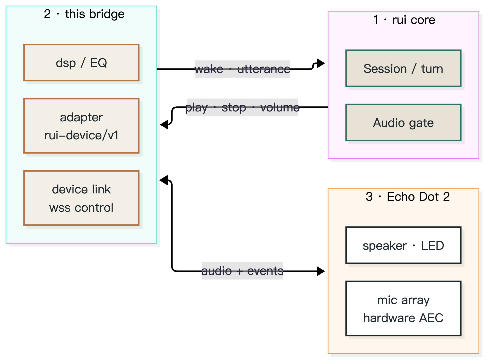

<div align="center">

# rui-dot2-bridge

**把 Echo Dot 2（RS03QR）接到 [rui](https://github.com/yes999zc/rui) 的语音卫星桥。**
不改 rui 核心：一个纯外置插件（0.7.6 起核心不再内置设备实现，本仓库是唯一来源）；设备侧 AEC 归设备，服务端只做决策。

[](LICENSE)
[](https://github.com/yes999zc/rui)
[](src/rui_dot2_bridge/plugin.yaml)

</div>

---

# 中文

## 15 秒了解

Echo Dot 2 保留它自己的麦克风阵列、硬件 AEC 和喇叭；唤醒、对话、播放都由你的 rui 服务决定。这个仓库提供一个遵循 `rui-device/v1`（Socket & Plug v1）契约的**外置插件**：挂到核心的 `/opt/rui-plugins` 即可，**不需要造下游镜像**。

```text
rui 起一个音频平面 → 插件连上设备（wss 控制通道 + 双向音频）→ 说「你好小瑞」→ rui 决定这一轮 → 插件播报/报灯/停播
```

## 架构



源文件：[`docs/assets/architecture.mmd`](docs/assets/architecture.mmd)；导出物 [`architecture.svg`](docs/assets/architecture.svg) / [`architecture.png`](docs/assets/architecture.png)。桥仓没有独立界面，hero 即这张架构图。

| 层 | 在这个仓库里的东西 | 说明 |
|---|---|---|
| **rui 核心（不改）** | 会话/回合、供应商、唤醒仲裁、音频门限 | 用官方镜像，不补丁、不 fork |
| **本仓库（插件）** | `adapter`（`build()` 入口）、`device_link`（wss 控制通道）、`dsp`（EQ/限幅） | 插件清单声明 `rui_compat`，越界时核心会拒载 |
| **设备** | Echo Dot 2 / RS03QR：麦克风阵列、硬件 AEC、喇叭、LED | 设备侧音频参数通过控制通道下发 |

## 特性

- **不改核心**：插件通过 `rui-device/v1` 契约接入；兼容窗口 `>=0.7.0 <0.9.0` 同时覆盖 0.7.x 与 0.8.x，rui 升级到下一个次版本不会让插件失效。
- **双向音频**：上行麦克风、下行播放分开走；播放/停止/音量/指示灯都是独立命令。
- **播放期门控**：`DOT2_PLAYBACK_GATE_MS` 控制「播放时静音上行」的时长（`0` = 交给设备 AEC，配合服务端中文 KWS 时可实现播放中打断）。
- **EQ 与限幅**：`dsp.py` 按房间响度目标做低切与高频搁架，并保证不削波（目标值可用 `/loudness` 复核）。
- **可观测**：`plug-test` 跑契约自测；设备状态、重连、丢包都进 rui 的日志与轨迹。

### 物理按键

设备上报的是 evdev 键码（`clickType`），不是键名；静音状态在同一条消息的 `muted`
字段里。插件把按键映射成 `drain_signals()` 事件交给 rui：

| `clickType` | 物理键 | 事件 `kind` | `text` |
|---|---|---|---|
| 113 | 静音 | `mute` / `unmute`（按 `muted`） | `muted` / `unmuted` |
| 114 | 音量 − | `volume_down` | 观测到的 `muted` |
| 115 | 音量 + | `volume_up` | 观测到的 `muted` |
| 138 | 动作键（圆点） | `action` | 观测到的 `muted` |

- 只在按下（`down: true`）时发一条事件，释放不重复触发。
- 未识别的 `clickType` 每个进程只记一条 `INFO` 日志并忽略，绝不猜成动作键。
- `muted` 同时写进适配器 `/health` 的 `muted`（每设备），与部署期的 `DOT2_MUTE`
  无关：后者是音量上限，改它要重启；前者是设备自己的静音键，按下即生效。
- 音量键只上报（明确带 `muted`），不改配置/不写回设备；写回属于 task-19。

## 三行启动

```bash
git clone --branch v1.3.1 https://github.com/yes999zc/rui-dot2-bridge.git && cd rui-dot2-bridge
mkdir -p /vol1/rui/plugins && cp -r src/rui_dot2_bridge /vol1/rui/plugins/   # 宿主插件目录
IMG=ghcr.io/yes999zc/rui@sha256:1f074bb3af1ef4854ef040b12c9146ed8a6ef2b1c4a5f6cc7858ac6ccac3ecaa
docker run --rm -v /vol1/rui/plugins:/opt/rui-plugins:ro -e PYTHONPATH=/opt/rui-plugins \
  --entrypoint rui "$IMG" plug-test /opt/rui-plugins/rui_dot2_bridge \
  --adapter rui_dot2_bridge.adapter:build   # 契约自测（directory 必填）
```

生产用 Compose：核心镜像 + `-v ./plugins:/opt/rui-plugins:ro` + `PYTHONPATH=/opt/rui-plugins` + `RUI_ADAPTER_PLUGINS=dot2=rui_dot2_bridge.adapter:build`，再按设备设 `DOT2_HOST` / `DOT2_LISTEN_PORT` / `DOT2_EM_TOKEN`（模板见 `deploy/`）。**不需要造下游镜像**。

## 新设备接入（一条命令）

已解锁 + 已刷 EchoMuse 的 Dot 2，一条命令指到本部署：改的是设备 `/data/local/etc/echomuse/` 下的
`controller.json` / `ca.pem` / `token`（备份 → 写入 → 逐字节读回校验 → 重启设备 server → 等 rui 报 connected）。
主机、端口、令牌、序列号全是参数，**仓库里没有任何真实部署信息**。

```bash
python scripts/onboard_device.py --device-id dot2-b --rui http://<your-rui>:8080 \
  --rui-token-file ~/.rui/console-token.txt --secrets-dir ~/rui/dot2-secrets   # 先加 --dry-run 看计划
```

要填哪些参数、两种模式（只改地址 / 换部署）、回滚与常见错误见 [docs/onboard-device.md](docs/onboard-device.md)。

## 让 AI 帮你装

把下面这段贴给任意 AI 助手：

```text
目标：用 Docker 跑起 rui 0.7.8 + 本插件 1.3.1（adapter id = dot2），核心镜像 + 外置插件目录，不造下游镜像。
前置：docker compose version 通过；8080 空闲；5 GB 磁盘。
1) git clone --branch main https://github.com/yes999zc/rui.git && cd rui/examples/two-speakers   # main 才有本示例；镜像 pin 到 0.7.8 的 amd64 摘要（digest 见上）
2) git clone --branch v1.3.1 https://github.com/yes999zc/rui-dot2-bridge.git && git clone --branch v0.2.2 https://github.com/yes999zc/rui-xiaoai-bridge.git
3) mkdir -p plugins && cp -r rui-dot2-bridge/src/rui_dot2_bridge plugins/   # 需要两台都接时，把另一个桥的 src 也 cp 进来
4) 写 ./config/config.yaml（web.auth_token + devices[]，含 dot2 的 host/listen_port）
5) TLS（dot2 的 tls_port 开启时必需）：把原 controller 证书放到 ./secrets/（server.pem + server.key）；没有就运行 `bash ../../scripts/make_dev_tls.sh` 自签。自签只保证平面能起，真机是否接受取决于设备信任的 CA
6) export DOT2_EM_TOKEN=<设备令牌>; docker compose up -d
7) 验收：/health 的 planes 里 dot2 为 running、devices 正确、device_errors=0（`RUI_ADAPTER_PLUGINS` 的注册项会出现在 `registered`；只有 `RUI_PLUGINS_DIR` 的 catalog 不进）
失败看：docker compose logs --tail=80 rui 的 config error / adapter / TLS；回滚：down 后换回上一版 image tag；TLS 失败先移走 ./secrets/ 排查
不需要自己编译 ffmpeg（镜像已内置）
```

## 兼容性与前置条件

- `rui` **>=0.7.0 <0.9.0**（双窗口：0.7.x + 0.8.x；`tested_with` 标注 **0.7.9**，下方镜像 pin 仍是已验摘要的 0.7.8）；Python **3.11+**（核心镜像已内置）。
- 安装：核心镜像 + 外置插件目录（`/vol1/rui/plugins/rui_dot2_bridge`），挂载 `/opt/rui-plugins` 并设 `PYTHONPATH` + `RUI_ADAPTER_PLUGINS`；**不需要造下游镜像**。
- **设备前置条件**（第三方设备，与厂商**无官方关联**）：
  - Echo Dot 2（RS03QR），固件需已具备设备本地接口并能与 rui 主机互通；
  - 设备与本服务在**同一局域网**；`DOT2_HOST` / 端口 / 设备令牌由你提供；
  - 本项目只提供软件侧的桥接层；设备固件、网络与令牌的准备由你按厂商与设备的既有能力完成（见上两条前置条件）。
- 中文唤醒词：走 rui 服务端 KWS（中文）；设备端 OWW 目前只用于英文模型，`DOT2_OWW_ON_DEVICE=off` 时完全关闭。
- 播放音乐需要 rui 侧配置音乐源（如 Navidrome）。

| rui 核心 | 本插件 | 说明 |
|---|---|---|
| **0.7.8**（当前） | **1.3.2** | 推荐；核心 + 外置插件目录（窗口覆盖 0.7.x / 0.8.x） |
| 0.7.4（历史） | 1.3.1 | 外置插件同样可用 |

**已知限制**：未声明 `wake_words_residual` 的第三方清单不做 vendor 短语兜底；两音箱默认只起第一台设备的平面（需 `multi_device`）；自签证书只保证平面能起，真机信任取决于设备 CA。

## 支持矩阵

> 与 `docs/canary-0.6.0-official-image.md` 的 **0.6.0 官方镜像 canary 轮次（2026-10-26，未接真机）** 不同轮次，数字不可互证。

| 能力 | 状态 |
|---|---|
| 唤醒（服务端中文 KWS） | 30/30 admitted（2026-10-26，6 句 × 5 轮，校准后 TTS 音源） |
| 语音指令 | 26/30（同上，含音乐占据扬声器的场景） |
| 播放中打断（barge-in） | 8/8（2026-10-26，真机人声；**stop-push 判据**，非声学端到端） |
| 音乐中短指令（下一首 / 停止播放） | 10/10（2026-10-26，人声，1 m） |
| 音量控制 | **控制端点**的 5 档 set/read 系统化验证**未验证**；回读一致性已修复，且有回归测试（m1 #4）；响度/EQ 是下一行的独立项 |
| 指示灯 | 未测 |
| EQ / 限幅 | 测量通过（`tools/eq_report.py`：100–300 Hz vs 1–3 kHz 由 +24.65 dB 降到 +2.11 dB、限幅 −12.85 → −2.19 dB、0 削波）；**耳测未做** |
| 多设备并发 | 未测 |

## 故障排查

| 现象 | 原因 | 处置 |
|---|---|---|
| 插件没被加载 | `rui_compat` 越界或 `plugin.yaml` 不在模块目录 | 看 rui 启动日志里的 manifest 报错；确认 rui 版本在窗口内 |
| 设备连不上 | `DOT2_HOST` / 端口 / 令牌错，或设备不在同一网段 | 先 `rui plug-test`，再看 `device_link` 的重连日志 |
| 播放时喊不醒 | `DOT2_PLAYBACK_GATE_MS` 让上行被静音 | 调小或设 `0`（由设备 AEC 负责），再用中文 KWS 验证打断 |
| 加第二台设备后第一台失效 | 旧版 `DOT2_CONTROL_PORT` / `DOT2_LOUDNESS_FILE` 只能全局配置 | 升级后 5 项都按设备取：在 `devices[].params` 里给每台写 `control_port`（不同端口或 `0`）、`loudness_file`、`eq_dir`、`secrets_dir`、`oww_threshold`；env 仍作单台 fallback |
| 声音发闷/发尖 | EQ 目标与房间不匹配 | 重跑 `tools/eq_report.py` 拿测量值，再调 `DOT2_LOUDNESS_*` / `DOT2_EQ_DIR` |
| 中文唤醒词没反应 | 打开了设备端 OWW 但只有英文模型 | 设 `DOT2_OWW_ON_DEVICE=off`，用服务端中文 KWS |

## 已知限制

- 设备端 OWW 只验证过英文模型；中文唤醒词依赖 rui 服务端 KWS。
- EQ 只有测量结论，**没有**人工耳测结论；不同房间仍需现场调。
- 播放与拾音的共存依赖设备 AEC；设备固件不同，打断延迟可能在数百毫秒量级。
- 多台 Dot2 并发、音量与指示灯的系统性验证未做。

## 致谢

契约 `rui-device/v1` 与 `plug-test` 工具来自 [rui](https://github.com/yes999zc/rui)；音频参数化思路参考了公开的设备音频调试实践（见 `docs/aec-*.md`）。

## License

[MIT](LICENSE)。

---

# English

## In 15 seconds

The Echo Dot 2 keeps its own microphone array, hardware AEC and speaker; wakes, dialogue and playback are decided by your rui server. This repository ships one **external plug** implementing the `rui-device/v1` (Socket & Plug v1) contract: mount it at the core's `/opt/rui-plugins`; **no downstream image is needed**.

```text
rui starts an audio plane → the plug links to the device (wss control + duplex audio) → "Hey Rui" → rui decides the turn → the plug speaks / lights / stops
```

## Architecture


Source: [`docs/assets/architecture.mmd`](docs/assets/architecture.mmd); exports [`architecture.svg`](docs/assets/architecture.svg) / [`architecture.png`](docs/assets/architecture.png). A bridge has no UI of its own, so this diagram is the hero.

| Layer | What lives here | Notes |
|---|---|---|
| **rui core (unchanged)** | Sessions/turns, providers, wake arbitration, audio gate | Official image, no patches, no fork |
| **This repo (plug)** | `adapter` (`build()` entry), `device_link` (wss control), `dsp` (EQ/limiter) | The manifest declares `rui_compat`; out-of-range versions are refused by the loader |
| **Device** | Echo Dot 2 / RS03QR: mic array, hardware AEC, speaker, LED | Device audio parameters are pushed over the control channel |

## Features

- **No core changes**: the plug speaks `rui-device/v1`; the window `>=0.7.0 <0.9.0` spans both the 0.7.x and 0.8.x lines, so a rui minor bump will not break it.
- **Duplex audio**: microphone uplink and playback downlink are separate; play/stop/volume/LED are individual commands.
- **Playback gate**: `DOT2_PLAYBACK_GATE_MS` sets how long the uplink is muted while playing (`0` = leave it to the device AEC, which enables barge-in together with server-side Chinese KWS).
- **EQ and limiting**: `dsp.py` applies a low cut and high shelf toward the room's loudness target without clipping (verify with `/loudness`).
- **Observability**: `plug-test` runs the contract suite; device state, reconnects and drops show up in rui logs and traces.

### Physical buttons

The device reports evdev key codes (`clickType`), not key names; the mute state
travels in the same frame's `muted` field. The plug maps keys to
`drain_signals()` events for rui:

| `clickType` | Physical key | Event `kind` | `text` |
|---|---|---|---|
| 113 | mute | `mute` / `unmute` (from `muted`) | `muted` / `unmuted` |
| 114 | volume down | `volume_down` | observed `muted` |
| 115 | volume up | `volume_up` | observed `muted` |
| 138 | action (dot) | `action` | observed `muted` |

- One event per press (`down: true`); the release never double-fires.
- An unknown `clickType` is logged once per process at `INFO` and ignored; it is
  never guessed into an action.
- `muted` also appears in the adapter's per-device `/health` as `muted`. This is
  not `DOT2_MUTE` (a deploy-time volume ceiling that needs a restart): the key is
  device-sovereign and takes effect immediately.
- Volume keys are reported only (with the observed `muted`); config/device
  writeback is task-19.

## Three-line quickstart

```bash
git clone --branch v1.3.1 https://github.com/yes999zc/rui-dot2-bridge.git && cd rui-dot2-bridge
mkdir -p /vol1/rui/plugins && cp -r src/rui_dot2_bridge /vol1/rui/plugins/   # host plug dir
IMG=ghcr.io/yes999zc/rui@sha256:1f074bb3af1ef4854ef040b12c9146ed8a6ef2b1c4a5f6cc7858ac6ccac3ecaa
docker run --rm -v /vol1/rui/plugins:/opt/rui-plugins:ro -e PYTHONPATH=/opt/rui-plugins \
  --entrypoint rui "$IMG" plug-test /opt/rui-plugins/rui_dot2_bridge \
  --adapter rui_dot2_bridge.adapter:build   # contract self-test (directory required)
```

In production use Compose: core image + `-v ./plugins:/opt/rui-plugins:ro` + `PYTHONPATH=/opt/rui-plugins` + `RUI_ADAPTER_PLUGINS=dot2=rui_dot2_bridge.adapter:build`, then set `DOT2_HOST` / `DOT2_LISTEN_PORT` / `DOT2_EM_TOKEN` per device (templates under `deploy/`). **No downstream image is needed**.

## Onboard a new device (one command)

For an unlocked, EchoMuse-flashed Dot 2, one command rewrites the device's
`/data/local/etc/echomuse/{controller.json,ca.pem,token}` (backup → write → byte-for-byte
read-back → restart the device server → wait until rui reports it connected).
Every host, port, token and serial is a flag; no real deployment details live in this repo.

```bash
python scripts/onboard_device.py --device-id dot2-b --rui http://<your-rui>:8080 \
  --rui-token-file ~/.rui/console-token.txt --secrets-dir ~/rui/dot2-secrets   # add --dry-run to preview
```

See [docs/onboard-device.md](docs/onboard-device.md) for the parameter list, the two modes
(repoint only vs. re-provision), rollback and troubleshooting.

## Let an AI install it

Paste this:

```text
Goal: run rui 0.7.8 + this plug 1.3.1 (adapter id = dot2) with Docker, using the core image plus an external plug directory (no downstream image).
Preflight: docker compose version; port 8080 free; 5 GB disk.
1) git clone --branch main https://github.com/yes999zc/rui.git && cd rui/examples/two-speakers   # main 才有本示例；镜像 pin 到 0.7.8 的 amd64 摘要（digest 见上）
2) git clone --branch v1.3.1 https://github.com/yes999zc/rui-dot2-bridge.git && git clone --branch v0.2.2 https://github.com/yes999zc/rui-xiaoai-bridge.git
3) mkdir -p plugins && cp -r rui-dot2-bridge/src/rui_dot2_bridge plugins/   # 需要两台都接时，把另一个桥的 src 也 cp 进来
4) write ./config/config.yaml (web.auth_token + devices[] with host/listen_port for dot2)
5) TLS (required when dot2's tls_port is on): put the original controller cert into ./secrets/ (server.pem + server.key); if you do not have it, run `bash ../../scripts/make_dev_tls.sh`. Self-signed only proves the plane starts; the device's trusted CA decides acceptance
6) export DOT2_EM_TOKEN=<device token>; docker compose up -d
7) verify: /health.planes shows dot2 running, devices correct, device_errors=0 (entries listed in `RUI_ADAPTER_PLUGINS` do show up in `registered`; only the `RUI_PLUGINS_DIR` catalog stays out)
On failure: docker compose logs --tail=80 rui (config error / adapter / TLS); rollback: down and switch the image tag back; for TLS failures move ./secrets/ away first
No ffmpeg build needed (the image ships it)
```

## Compatibility and prerequisites

- `rui` **>=0.7.0 <0.9.0** (dual window: 0.7.x + 0.8.x; `tested_with` names **0.7.9**, while the image pin below stays on the verified 0.7.8 digest); Python **3.11+** (bundled in the core image).
- Install: core image + external plug directory (`/vol1/rui/plugins/rui_dot2_bridge`), mounted at `/opt/rui-plugins` with `PYTHONPATH` + `RUI_ADAPTER_PLUGINS`; **no downstream image is needed**.
- **Device prerequisites** (third-party hardware, **not affiliated with any vendor**):
  - Echo Dot 2 (RS03QR) whose firmware already exposes the device's local interface and can reach the rui host;
  - device and server on the **same LAN**; `DOT2_HOST`, ports and the device token are yours to provide;
  - this project only provides the software bridge; preparing the device firmware, network and token is up to you, using the device's existing capabilities (see the two prerequisites above).
- Chinese wake words come from rui's server-side KWS; the on-device OWW path only ships an English model and is off by default (`DOT2_OWW_ON_DEVICE=off`).
- Music needs a source configured on the rui side (e.g. Navidrome).

| rui core | This plug | Notes |
|---|---|---|
| **0.7.8** (current) | **1.3.2** | Recommended; core image + external plug directory (window covers 0.7.x / 0.8.x) |
| 0.7.4 (historical) | 1.3.1 | The external plug works the same way |

**Known limitations**: a third-party manifest without `wake_words_residual` gets no vendor-phrase backstop; two speakers start one plane by default unless `multi_device` is enabled; a self-signed certificate only starts the plane, real-device trust depends on its CA.

## Support matrix

> This is a different run from `docs/canary-0.6.0-official-image.md` (0.6.0 official-image canary, 2026-10-26, no real device); the numbers are not interchangeable.

| Capability | Status |
|---|---|
| Wake (server-side Chinese KWS) | 30/30 admitted (2026-10-26, 6 phrases × 5 rounds, calibrated TTS source) |
| Voice commands | 26/30 (same run, including music-owns-speaker cases) |
| Barge-in during playback | 8/8 (2026-10-26, real voice; **stop-push criterion**, not acoustical end-to-end) |
| Short commands during music (next / stop) | 10/10 (2026-10-26, human voice, 1 m) |
| Volume control | systematic 5-step set/read of the **control endpoint** is **unverified**; read-back consistency is fixed, with a regression test (m1 #4); loudness/EQ is the separate row below |
| LED | untested |
| EQ / limiting | measurement passed (`tools/eq_report.py`: 100–300 Hz vs 1–3 kHz from +24.65 dB to +2.11 dB, limiting −12.85 → −2.19 dB, zero clipping); **no listening test** |
| Concurrent multi-device | untested |

## Troubleshooting

| Symptom | Cause | Fix |
|---|---|---|
| Plug never loads | `rui_compat` out of range, or `plugin.yaml` not next to the module | Check the manifest error in rui's startup log; confirm the rui version is inside the window |
| Device will not connect | Wrong `DOT2_HOST` / port / token, or a different subnet | Run `rui plug-test` first, then read `device_link` reconnect logs |
| It cannot hear you while playing | `DOT2_PLAYBACK_GATE_MS` mutes the uplink during playback | Lower it or set `0` (device AEC takes over) and re-test barge-in with Chinese KWS |
| A second device breaks the first | The old `DOT2_CONTROL_PORT` / `DOT2_LOUDNESS_FILE` were host-global | All five knobs resolve per device now: set `control_port` (a distinct port or `0`), `loudness_file`, `eq_dir`, `secrets_dir` and `oww_threshold` under each `devices[].params`; env stays as a single-device fallback |
| Sound is dull or harsh | EQ target does not match the room | Re-run `tools/eq_report.py`, then tune `DOT2_LOUDNESS_*` / `DOT2_EQ_DIR` |
| Chinese wake word ignored | On-device OWW enabled with an English-only model | Set `DOT2_OWW_ON_DEVICE=off` and rely on server-side KWS |

## Known limitations

- The on-device OWW path is only validated with an English model; Chinese wake words rely on server-side KWS.
- EQ has measurements only — **no** listening test; each room still needs on-site tuning.
- Playback and capture coexistence depends on the device AEC; barge-in latency can be in the hundreds of milliseconds depending on firmware.
- Concurrent Dot2 units, volume and LED behaviour have not been systematically verified.

## Credits

The `rui-device/v1` contract and the `plug-test` tool come from [rui](https://github.com/yes999zc/rui); the audio parametrisation follows public device-audio debugging practice (see `docs/aec-*.md`).

## License

[MIT](LICENSE).
